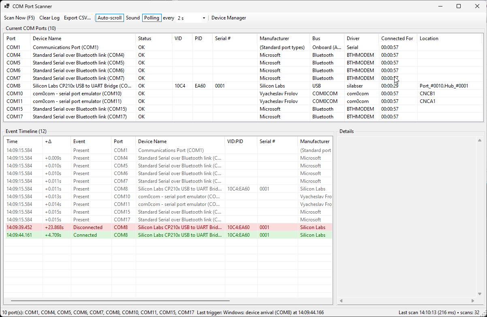

# ComScanner

**A real-time COM (serial) port monitor for Windows.** ComScanner shows every serial port on your machine and records a timestamped timeline as devices are plugged in, unplugged, swapped or start having driver problems. Use it to track and debug USB-to-serial adapters, Arduinos, ESP32s, CP210x/FTDI/CH340 boards, Bluetooth serial links and virtual ports.



---

## Table of Contents

- [Features](#features)
- [Product Overview](#product-overview)
  - [Toolbar](#toolbar)
  - [Current COM Ports](#current-com-ports)
  - [Event Timeline](#event-timeline)
  - [Details Pane](#details-pane)
  - [Status Bar](#status-bar)
- [Event Types](#event-types)
- [Requirements](#requirements)
- [Getting Started](#getting-started)
- [How It Works](#how-it-works)
- [Exporting the Log](#exporting-the-log)
- [Debugging Tips](#debugging-tips)
- [Project Structure](#project-structure)
- [Known Limitations](#known-limitations)
- [Troubleshooting](#troubleshooting)

---

## Features

- **Instant change detection.** The app listens for Windows device-change notifications (`WM_DEVICECHANGE`), so plug and unplug events appear within about half a second.
- **Optional polling.** A periodic rescan (1 s to 30 s) catches changes Windows doesn't announce, such as a driver failure or a device that gets disabled.
- **Timestamped event timeline.** Each event has a millisecond-precision timestamp and the time since the previous event, colour-coded by type.
- **Detailed device info.** For each port you see the friendly name, manufacturer, **VID/PID**, **serial number**, bus type, driver service, physical location, kernel device object and full PnP Device ID.
- **Plain-language error codes.** Device Manager problem codes are shown with a short explanation, e.g. `Code 28: Drivers not installed` or `Code 43: Device reported a problem`.
- **Device tracking:**
  - how long each port has been connected (live counter)
  - how long a port was absent before it came back
  - when the *same* physical device comes back on a *different* COM number
  - when a *different* device takes over an existing COM number
- **Per-port history.** Click any port or event to see everything that has happened to that port.
- **CSV export** of the full timeline for bug reports or later analysis.
- **Optional sound** when a port connects or disconnects.
- **Non-intrusive.** ComScanner **never opens a port**, so it won't reset boards (like Arduinos) that restart when a port is opened, and it won't block other apps from using the port.

---

## Product Overview

The window has five areas, top to bottom:

```
┌───────────────────────────────────────────────────────────────────────┐
│ Toolbar: Scan Now | Clear Log | Export CSV | Auto-scroll | Sound | ...│
├───────────────────────────────────────────────────────────────────────┤
│ Current COM Ports  (live table of every port that is present now)     │
├──────────────────────────────────────────────┬────────────────────────┤
│ Event Timeline  (time-ordered change log)    │ Details  (selected     │
│                                              │ port / event + history)│
├──────────────────────────────────────────────┴────────────────────────┤
│ Status bar: ports present | last trigger | last scan time             │
└───────────────────────────────────────────────────────────────────────┘
```

All panes can be resized by dragging the splitters.

### Toolbar

| Control | Description |
|---|---|
| **Scan Now (F5)** | Rescans all COM ports immediately. |
| **Clear Log** | Clears the event timeline and details pane. The current port list is kept. |
| **Export CSV...** | Saves the whole timeline to a CSV file. |
| **Auto-scroll** | When on, the timeline scrolls to the newest event automatically. |
| **Sound** | Plays a system sound when a port connects, disconnects or is replaced. |
| **Polling / every N s** | Turns the periodic rescan on or off and sets its interval (1, 2, 5, 10 or 30 s). Device notifications still work with polling off. |
| **Device Manager** | Opens Windows Device Manager (`devmgmt.msc`). |

### Current COM Ports

A live table of every serial port currently present, sorted by port number.

| Column | Description |
|---|---|
| **Port** | COM port name, e.g. `COM3`. |
| **Device Name** | Windows friendly name, e.g. `Silicon Labs CP210x USB to UART Bridge (COM3)`. |
| **Status** | `OK`, or the error status with its Device Manager code and meaning. |
| **VID / PID** | USB Vendor ID and Product ID (USB devices only). |
| **Serial #** | The device's own USB serial number, if it reports one (FTDI serials are also read). |
| **Manufacturer** | Driver-reported manufacturer. |
| **Bus** | `USB`, `USB (FTDI)`, `Bluetooth`, `Onboard (ACPI)`, `PCI`, `Virtual (Root)`, or the raw bus enumerator name. |
| **Driver** | Windows driver service name, e.g. `silabser`, `usbser`, `FTDIBUS`, `BTHMODEM`. |
| **Connected For** | Live time since the port appeared (or since the app started). |
| **Location** | Physical location info, e.g. `Port_#0002.Hub_#0001`. |

Rows for devices with a problem are highlighted in **orange with red text**.

### Event Timeline

A time-ordered log of everything that has happened since the app started.

| Column | Description |
|---|---|
| **Time** | Local time with milliseconds (`HH:mm:ss.fff`). |
| **+Δ** | Time since the previous event. Useful for spotting devices that disconnect and reconnect repeatedly. |
| **Event** | The event type (see [Event Types](#event-types)). |
| **Port** | The affected COM port. |
| **Device Name / VID:PID / Serial # / Manufacturer / Status** | A snapshot of the device *at the time of the event*. |
| **Info** | Extra context, e.g. `Was connected for 00:12:41`, `Port was absent for 00:00:03`, `Same device was previously on COM5`, or a before → after description of a status change. |

### Details Pane

Click a row in either table to see:

- **Port selected:** every property of the current device, the exact time it connected, and the full history of that COM port.
- **Event selected:** the event's full timestamp, type, info and time since the previous event, the device snapshot taken *when the event happened*, and the port's history.

The text uses a monospaced font, so you can copy and paste it straight into a bug report.

### Status Bar

- **Left:** how many ports are present and their names.
- **Middle:** what triggered the last scan and when, e.g. `Windows: device arrival (COM7) at 14:03:22.418` or `Manual scan`.
- **Right:** when the last scan ran, how long it took, and the total number of scans.

---

## Event Types

| Event | Colour | Meaning |
|---|---|---|
| **Present** | Gray | The port already existed when ComScanner started. |
| **Connected** | 🟩 Green | A new COM port appeared. |
| **Disconnected** | 🟥 Red | A COM port disappeared. *Info* shows how long it had been connected. |
| **Device Replaced** | 🟦 Blue | The COM number stayed the same but a different device (different PnP Device ID) now owns it. |
| **Status Changed** | 🟨 Yellow | Same device, but its status/error code, friendly name or driver changed. *Info* shows before → after. |
| **Error** | Pink | A scan failed (e.g. a WMI error). *Info* shows the error message. |

---

## Requirements

- **Windows 10 or 11.** ComScanner uses Windows-only APIs (WMI, registry, `WM_DEVICECHANGE`).
- **.NET 10 SDK** (to build) or the **.NET 10 Desktop Runtime** (to run).
- **Visual Studio 2026** (optional) with the *.NET desktop development* workload.
- No administrator rights needed. All the data it reads is readable by a standard user.

### Dependencies

| Package | Purpose |
|---|---|
| [`System.Management`](https://www.nuget.org/packages/System.Management) | Queries WMI (`Win32_PnPEntity`) for device information. |

---

## Getting Started

### Visual Studio

1. Open `ComScanner.slnx`.
2. Press **F5** to build and run.

### Command line

```powershell
git clone <your-repo-url> ComScanner
cd ComScanner
dotnet run
```

### Publish a standalone executable

```powershell
dotnet publish -c Release -r win-x64 --self-contained true -p:PublishSingleFile=true
```

The executable is written to `bin\Release\net10.0-windows\win-x64\publish\ComScanner.exe`.

### Basic usage

1. Start ComScanner. Every port that already exists is logged as **Present**.
2. Plug in a USB serial device. A green **Connected** event appears within about half a second.
3. Unplug it. A red **Disconnected** event appears, showing how long it was connected.
4. Click any row to see full details and that port's history.
5. Click **Export CSV...** to save the session.

---

## How It Works

### Change detection

ComScanner uses two triggers:

1. **Windows device notifications.** The main form overrides `WndProc` and handles `WM_DEVICECHANGE` with `DBT_DEVICEARRIVAL`, `DBT_DEVICEREMOVECOMPLETE` and `DBT_DEVNODES_CHANGED`. For port-type broadcasts (`DBT_DEVTYP_PORT`), the port name is read from `DEV_BROADCAST_PORT` and shown in the status bar. Windows usually sends a burst of these messages for one plug/unplug, so they are **debounced** (400 ms) into a single rescan.
2. **Polling** (optional, on by default every 2 s). Catches changes that Windows doesn't send a notification for, such as a driver failing to load or a device being disabled.

If a scan is already running when a new trigger arrives, another scan is queued so no change is missed.

### Port enumeration

Each scan runs on a background thread and combines three sources:

| Source | Used for |
|---|---|
| **WMI `Win32_PnPEntity`** (Ports class GUID `{4d36e978-e325-11ce-bfc1-08002be10318}`, or any device whose name contains `(COM`) | Friendly name, description, manufacturer, PnP Device ID, driver service, status, `ConfigManagerErrorCode` |
| **`HKLM\SYSTEM\CurrentControlSet\Enum\<PnPDeviceID>\Device Parameters\PortName`** | The exact COM port name. Falls back to parsing `(COMx)` from the friendly name. |
| **`HKLM\SYSTEM\CurrentControlSet\Enum\<PnPDeviceID>\LocationInformation`** | Physical location |
| **`HKLM\HARDWARE\DEVICEMAP\SERIALCOMM`** | Kernel device object (e.g. `\Device\Silabser0`), and ports that have no PnP device (legacy/virtual) |

VID, PID, serial number and bus type are parsed from the PnP Device ID:

| PnP Device ID example | Parsed |
|---|---|
| `USB\VID_10C4&PID_EA60\0001` | VID `10C4`, PID `EA60`, serial `0001`, bus `USB` |
| `FTDIBUS\VID_0403+PID_6001+A50285BIA\0000` | VID `0403`, PID `6001`, serial `A50285BIA`, bus `USB (FTDI)` |
| `USB\VID_2341&PID_0043\6&1A2B3C&0&2` | VID `2341`, PID `0043`, *no serial* (Windows-generated instance ID) |
| `BTHENUM\{00001101-...}\...` | bus `Bluetooth` |

LPT (printer) ports are excluded.

### Diffing

Each scan is compared with the previous one, port by port:

- port missing now → **Disconnected**
- new port → **Connected**
- same port, different PnP Device ID → **Device Replaced**
- same device, different status, name or driver → **Status Changed**

The app also remembers which COM port each PnP Device ID last used, so it can report when a device comes back on a different port number.

---

## Exporting the Log

**Export CSV...** writes a UTF-8 CSV file (default name `ComPortLog_yyyyMMdd_HHmmss.csv`) with these columns:

```
Timestamp,Event,Port,DeviceName,VID,PID,SerialNumber,Manufacturer,Status,Bus,Driver,Location,PnpDeviceId,Info
```

Example:

```csv
Timestamp,Event,Port,DeviceName,VID,PID,SerialNumber,Manufacturer,Status,Bus,Driver,Location,PnpDeviceId,Info
2026-11-21 14:02:10.115,Present,COM3,Silicon Labs CP210x USB to UART Bridge (COM3),10C4,EA60,0001,Silicon Labs,OK,USB,silabser,Port_#0002.Hub_#0001,USB\VID_10C4&PID_EA60\0001,Present at startup
2026-11-21 14:03:22.418,Disconnected,COM3,Silicon Labs CP210x USB to UART Bridge (COM3),10C4,EA60,0001,Silicon Labs,OK,USB,silabser,Port_#0002.Hub_#0001,USB\VID_10C4&PID_EA60\0001,Was connected for 00:01:12
2026-11-21 14:03:25.902,Connected,COM3,Silicon Labs CP210x USB to UART Bridge (COM3),10C4,EA60,0001,Silicon Labs,OK,USB,silabser,Port_#0002.Hub_#0001,USB\VID_10C4&PID_EA60\0001,Port was absent for 00:00:03
```

The file opens directly in Excel, or you can load it into any script or tool that reads CSV.

---

## Debugging Tips

| Symptom | What to look for in ComScanner |
|---|---|
| **Device keeps dropping out** | Repeated Disconnected/Connected pairs with small **+Δ** values. Common causes are a bad cable, a weak USB hub, power brown-outs, or firmware crashing and re-enumerating. |
| **"My device moved to a different COM port"** | The *Info* column shows `Same device was previously on COMx`. Windows assigns a new COM number when a device has no serial number or is plugged into a different USB port. |
| **Port appears, but my app can't open it** | Check **Status**. Codes 10, 28, 31, 39 or 43 mean a driver problem. Click **Device Manager** to fix it. |
| **Which physical board is which?** | Compare the **Serial #** and **Location** columns. Location tells you which USB hub port the device is plugged into. |
| **Two identical boards, unknown COM numbers** | Unplug one and watch which port gets a **Disconnected** event. |
| **Board resets when opening the port** | ComScanner never opens ports, so it can run alongside your terminal or IDE without causing resets. |
| **Driver swapped or updated** | A **Status Changed** event shows `Driver: old → new`. |

---

## Project Structure

```
ComScanner/
├── ComScanner.slnx            Solution file
├── ComScanner.csproj          WinForms project (.NET 10, System.Management)
├── Program.cs                 Application entry point
├── Form1.cs                   Main window: scanning, diffing, timeline, details, export
├── Form1.Designer.cs          UI layout (toolbar, splitters, list views, timers)
├── Form1.resx                 Form resources
├── ComPortInfo.cs             ComPortInfo record, PortEvent record, PortEventType enum, error-code descriptions
├── ComPortEnumerator.cs       WMI + registry COM port enumeration and PnP ID parsing
├── Images/
│   └── ComScanner.png         Product screenshot used in this README
└── README.md
```

### Key types

| Type | Responsibility |
|---|---|
| `ComPortEnumerator` | Static, thread-safe `Enumerate()` that returns a sorted `List<ComPortInfo>`. |
| `ComPortInfo` | Immutable snapshot of one port/device, with helper properties (`VidPid`, `StatusText`, `HasProblem`, `ToDetailsText()`). |
| `PortEvent` | Immutable timeline entry: timestamp, type, port, device snapshot, info, time since previous event. |
| `Form1` | UI, notification handling, debouncing, polling, diffing and export. |

---

## Known Limitations

- **Serial numbers** only appear for devices that report a real USB serial number. Many cheap CH340 and some CP210x boards don't, and devices with several functions on one USB connection (composite devices) report a Windows-generated ID instead. These show as `—`.
- **VID/PID** are only available for USB-based ports. Bluetooth, onboard and most virtual ports show `—`.
- The timeline is **kept in memory only**. Use **Export CSV...** to keep it, and **Clear Log** for very long sessions.
- **Status changes between polls** are only seen when polling is on (or at the next device notification).
- Windows-only.

---

## Troubleshooting

| Problem | Solution |
|---|---|
| No ports listed, but Device Manager shows some | Click **Scan Now (F5)**. If an **Error** event appears, the WMI service may be stopped. Run `winmgmt /verifyrepository` in an elevated prompt. |
| A port is listed with description *"No PnP device found (legacy or virtual port)"* | The port is in `SERIALCOMM` but has no matching PnP device. This is normal for some virtual COM port drivers. |
| Events appear slowly | Make sure polling is on, or lower the interval. Notification-based detection should normally respond in under 1 s. |
| Scan times are high (shown in the status bar) | WMI can be slow on machines with many devices. Raise the polling interval to 5–10 s. Plug/unplug detection still works instantly. |
